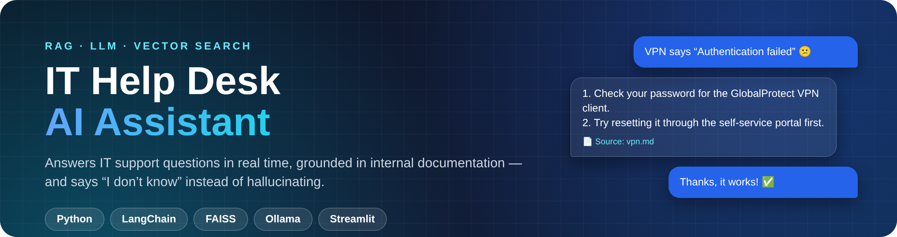
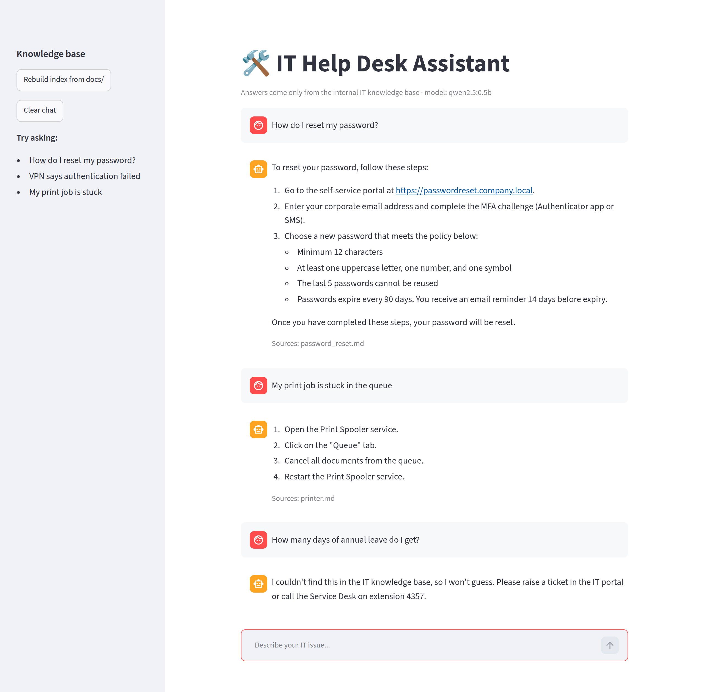
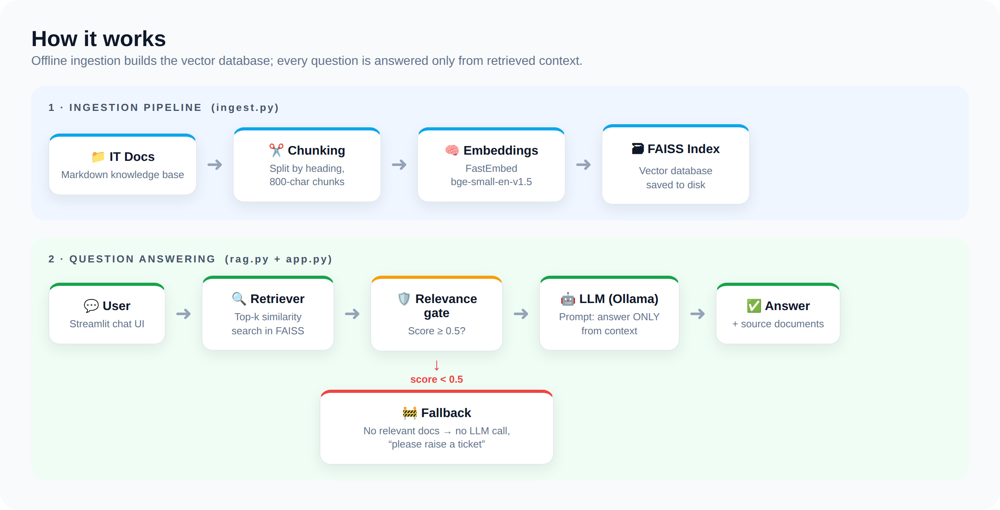

<p align="center">
  
</p>

<p align="center">
  
  
  
  
  
  
</p>

<p align="center">
  <b>An automated IT support chatbot that answers service desk questions in real time,<br>grounded in internal technical documentation using Retrieval-Augmented Generation.</b>
</p>

---

## ✨ Highlights

| | |
|---|---|
| 🧠 **RAG pipeline** | Internal IT docs are chunked, embedded and stored in a **FAISS vector database**; every answer is built from the most relevant chunks. |
| 🛡️ **No hallucinations** | A **relevance gate** drops low-scoring chunks. If nothing relevant is found, the LLM is never called and the user is pointed to the Service Desk. |
| 📄 **Cited answers** | Every response lists the source documents it came from, so users can trust the answer. |
| 🔒 **Runs 100% locally** | Local LLM via **Ollama** and local embeddings via **FastEmbed**: no API keys, no data leaves the machine. |
| 💬 **Live chat UI** | Clean **Streamlit** interface with chat history and one-click index rebuild. |

## 🎬 Demo

<p align="center">
  
</p>

> The first two questions are answered from the knowledge base with sources. The third (*annual leave*) is outside the IT docs, so the assistant **declines instead of guessing**.

## 🏗️ Architecture

<p align="center">
  
</p>

## 🚀 Quick start

```bash
# 1. Install Ollama (https://ollama.com/download) and pull a model
ollama pull qwen2.5:0.5b          # small & fast; llama3.2:3b or qwen2.5:7b give richer answers

# 2. Install dependencies
python -m venv .venv && source .venv/bin/activate
pip install -r requirements.txt
cp .env.example .env              # optional: change model, threshold, etc.

# 3. Build the vector database from docs/
python ingest.py

# 4. Launch the chat app
streamlit run app.py
```

Ask from the command line, or run the tests:

```bash
python rag.py "VPN says authentication failed"
pytest -q
```

## 📁 Project structure

```
it-helpdesk-assistant/
├── docs/            # Internal IT knowledge base (markdown)
├── ingest.py        # Data pipeline: load → chunk → embed → FAISS index
├── rag.py           # Retriever + relevance gate + LangChain prompt/LLM chain
├── app.py           # Streamlit chat interface
├── config.py        # Settings from .env
├── tests/           # Pytest: chunking, retrieval, out-of-scope fallback
└── assets/          # README images
```

## ⚙️ Configuration

| Variable | Default | Description |
|----------|---------|-------------|
| `OLLAMA_MODEL` | `qwen2.5:0.5b` | Any chat model pulled into Ollama |
| `OLLAMA_BASE_URL` | `http://localhost:11434` | Ollama server URL |
| `EMBEDDING_MODEL` | `BAAI/bge-small-en-v1.5` | FastEmbed embedding model |
| `TOP_K` | `4` | Chunks retrieved per question |
| `MIN_RELEVANCE` | `0.5` | Minimum relevance score (0–1) for a chunk to be used |

The `0.5` threshold was chosen from measured scores: in-scope questions scored **0.69–0.75**, while off-topic ones scored **0.18–0.46**.

## 📚 Using your own documentation

Drop markdown files into `docs/` and run `python ingest.py` again, or click **Rebuild index** in the app sidebar. Headings (`#`, `##`) become chunk boundaries, so well-structured docs retrieve best.

## 🗺️ Roadmap

- [ ] Ingest PDFs, Confluence and SharePoint pages
- [ ] Ticket creation (e.g. Jira / ServiceNow) when the bot can't answer
- [ ] Conversation memory for follow-up questions
- [ ] Docker image for one-command deployment

---

<sub>The documents in <code>docs/</code> are sample content written for this demo; URLs and phone extensions are placeholders.</sub>
